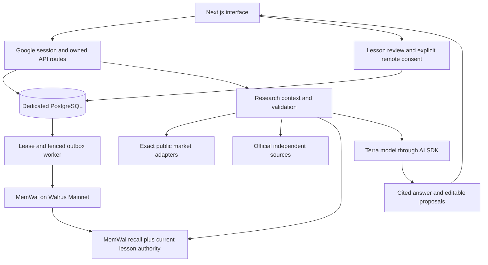

# ThesisBreak architecture

Status: local implementation and selected live integrations verified on 26 October 2026. Hosted release is pending. [Execution status](execution-status.md) is the dated evidence record; older implementation notes may describe earlier limitations.

ThesisBreak is a prediction research journal. A user saves a view and its reason, checks that reason against cited evidence, and reviews a result before deciding whether to keep a lesson for later research. It does not place trades.

## Account and journal

Google sign-in creates an application session. Server routes load the current account, exact provider/market identity and saved pick version. PostgreSQL stores journal versions, conversation runs, request receipts, evidence archives, watches and lesson authority. Separate local app and test databases have migrations through 0008 applied. Another project's database is not reused.

Pick drafts remain proposals. Applying a saved-pick change requires explicit confirmation against its current version. Account checks and idempotent receipts run in application code; model instructions are not an authorization boundary.

## Research and evidence

The server constructs context before calling the configured Terra model through the Vercel AI SDK and OpenAI-compatible provider binding. The model returns a structured answer, supplied references and optional proposals. Unknown citations and stale proposal versions are rejected. Durable run history and status SSE expose progress; this is status streaming, not streamed model tokens or execution resumed after a crash.

Live public Kalshi catalog/detail and final binary settlement reads have been checked. Polymarket and Tatum are separate provider paths, with no verified live Tatum credentials or settlement proof. Tatum is currently unconfigured.

Independent sources include the official NBA injury-report PDF, fixed newsroom routes for all 30 NBA teams, and Federal Reserve monetary-policy RSS. NBA mapping retains the exact game date, both matchup teams and player-team attribution; automatic mapping is limited to the inspected Kalshi NBA game format. Team announcements and Fed releases are background context. An injury report does not establish a confirmed starting lineup. BALLDONTLIE adapters exist but are unconfigured without a key.

Supported/contradicted reason labels require direct event evidence. Price movement or background articles alone cannot establish either. Final result comparison is calculated by code from the verified settlement and exact saved timestamp/version. Entries saved at or after settlement are `not_scored`; outcome agreement does not prove sound reasoning.

## Memory lifecycle

A suggested lesson first opens an editable review form with scope. Remote consent starts unchecked and applies to the exact approved version. A consented transaction queues an outbox event; the worker writes immutable bytes through the official MemWal SDK and requires exact blob readback before recording verification. Lease fencing, immutable retry material and stable logical identity protect retries; no exactly-once network guarantee is claimed.

Recall reads remote records and rechecks current owned lesson authority. Paused, retired, stale or out-of-scope versions cannot become active merely because they remain on Walrus. Resume requires renewed consent. Restore audits owned inventory and cannot re-authorize a lesson. No physical deletion of old remote blobs is claimed.

Owner-authorized provider configuration was reused for local acceptance, with credentials kept server-side. Actual Mainnet write/readback and later model reuse have passed. The signed-in Google account has one labelled demo preference; a separate acceptance context is not another production user. Ten useful Mainnet memories have not been established.

## Watches and limits

Users explicitly approve time-bounded market watches and may separately opt into NBA player-status checks. Per-watch baselines, exact full-name relevance, source-report deduplication, version checks, pause state and leases control notices. A naturally occurring live status-change alert still needs acceptance; this is not general semantic monitoring of every assumption.

The paired research regression used four fixed synthetic scenarios and eight real model calls. Both memory and no-memory variants passed 4/4 label/citation checks; memory references appeared in 4/4 memory cases. This demonstrates integration and regression behavior, with no measured prediction or reasoning-quality uplift. See [evaluation](research-evaluation.md), [reason review](reasoning-loop.md) and the [release checklist](evidence/release-checklist.md).
